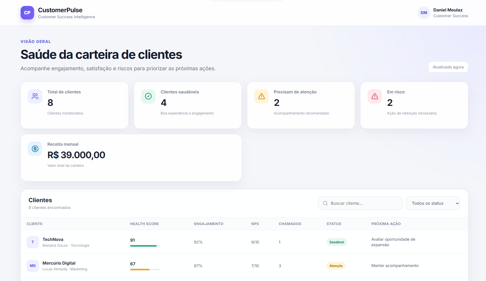
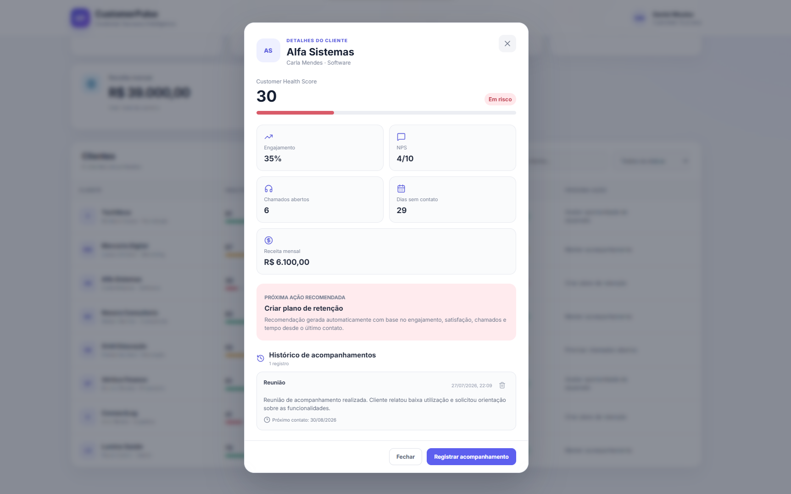

# CustomerPulse

Dashboard para monitoramento da saúde de clientes, identificação de riscos de churn e organização de ações de Customer Success.

Desenvolvi o CustomerPulse para praticar React e TypeScript aplicados a um cenário próximo da minha experiência com Customer Success Operations, suporte e acompanhamento de clientes.

## Projeto online

Acesse a aplicação: https://customer-pulses.vercel.app

## Capturas de tela

### Visão geral da carteira



### Detalhes e acompanhamento do cliente



## Sobre o projeto

O sistema analisa informações como engajamento, NPS, chamados abertos e tempo sem contato para gerar automaticamente um Customer Health Score.

Com base nessa pontuação, cada cliente é classificado como:

- Saudável
- Atenção
- Em risco

O objetivo é facilitar a identificação de clientes que precisam de acompanhamento, retenção ou ações de expansão.

## Funcionalidades

- Dashboard com indicadores gerais da carteira
- Cálculo automático do Customer Health Score
- Classificação dos clientes por nível de risco
- Busca por empresa, contato ou segmento
- Filtro por status
- Recomendações automáticas de próximas ações
- Visualização detalhada de cada cliente
- Registro de acompanhamentos
- Histórico de interações por cliente
- Definição da próxima data de contato
- Bloqueio de datas anteriores ao dia atual
- Exclusão de registros
- Mensagens de confirmação e erro
- Persistência dos dados com LocalStorage
- Interface responsiva

## Tecnologias utilizadas

- React
- TypeScript
- Vite
- CSS
- Lucide React
- LocalStorage

## Customer Health Score

A pontuação de saúde do cliente considera os seguintes indicadores:

- 35% de engajamento
- 25% de satisfação, com base no NPS
- 20% de volume de chamados abertos
- 20% de relacionamento, considerando o tempo sem contato

A classificação é definida da seguinte forma:

- 75 a 100: Saudável
- 50 a 74: Atenção
- 0 a 49: Em risco

## Recomendações automáticas

O sistema analisa os dados do cliente e recomenda ações como:

- Manter acompanhamento
- Avaliar oportunidade de expansão
- Agendar reunião de acompanhamento
- Priorizar chamados abertos
- Criar plano de retenção

## Executando o projeto

Clone o repositório:

```bash
git clone https://github.com/moul4z/customer-pulse.git
```

Entre na pasta:

```bash
cd customer-pulse
```

Instale as dependências:

```bash
npm install
```

Inicie o servidor de desenvolvimento:

```bash
npm run dev
```

Para gerar a versão de produção:

```bash
npm run build
```

## Próximas melhorias

- Integração com backend e banco de dados
- Autenticação de usuários
- Cadastro e edição de clientes
- Gráficos de evolução do Health Score
- Indicadores de churn e expansão
- Exportação de relatórios
- Integração com CRM

## Autor

Desenvolvido por Daniel Moulaz.

- LinkedIn: https://www.linkedin.com/in/daniel-moulaz
- GitHub: https://github.com/moul4z
